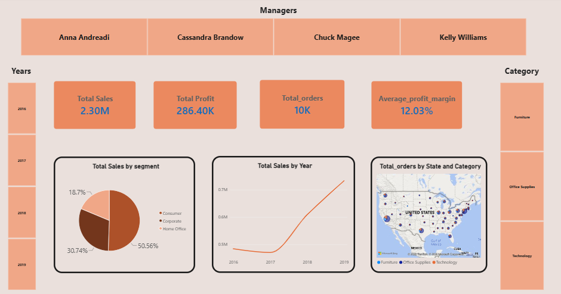
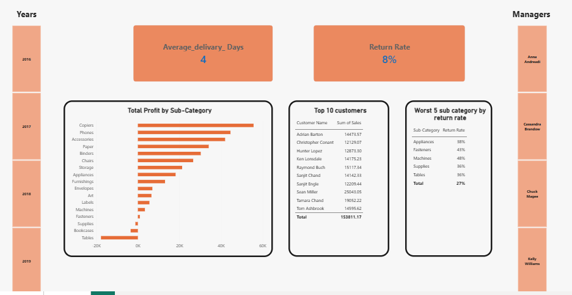

# Superstore Sales & Profit Analysis | Power BI

##  Project Overview

This project uses **Microsoft Power BI** to analyze Superstore sales data and present key business insights through an interactive, two pages dashboard.

The dashboard explores sales performance, profitability, customer segments, product categories, customer behavior, and product returns to help understand business performance and identify areas for improvement.

##  Tools Used

* Microsoft Power BI
* Data Visualization
* KPI Analysis
* Business Intelligence

##  Dashboard Preview

### Page 1: Sales Overview

This page provides an overview of business performance, including:

* Total Sales
* Total Profit
* Total Orders
* Average Profit Margin
* Sales by Customer Segment
* Sales Trends Over Time
* Orders by State and Product Category

### Page 2: Profitability & Returns

This page focuses on:

* Average Delivery Time
* Return Rate
* Profit by Product Sub-Category
* Top 10 Customers by Sales
* Sub-Categories with the Highest Return Rates

##  Project Objectives

* Analyze sales and profit performance over time.
* Understand the contribution of different customer segments.
* Identify profitable and less profitable product sub-categories.
* Explore customer sales performance.
* Examine product return rates to identify areas that may need further investigation.
* Present business data through clear and interactive visualizations.

## 📈 Key Metrics

| Metric                |   Value |
| --------------------- | ------: |
| Total Sales           |   2.30M |
| Total Profit          | 286.40K |
| Total Orders          |     10K |
| Average Profit Margin |  12.03% |
| Average Delivery Time |  4 Days |
| Return Rate           |      8% |

##  Project Files

* `Superstore_Sales_Analysis.pbix` — Interactive Power BI report.
* `screenshots/` — Images of both dashboard pages.

##  How to Explore the Project

1. Download the `.pbix` file from this repository.
2. Open it using Microsoft Power BI Desktop.
3. Explore the report pages and interact with the available filters.
4. Review the visualizations to investigate sales, profitability, customers, and returns.

##  What I Practiced

This project was completed as part of my Digital Egypt Pioneers Initiative (DEPI) internship. Throughout the project, I gained practical experience in building interactive Power BI dashboards, designing clear KPIs, analyzing business performance, and transforming raw data into meaningful visualizations that support data driven decision making.

I’m proud to have received a 100/100 grade from my instructor, recognizing my work on this project and marking an important milestone in my journey as a Data Analyst.

##  Data Source

This project was created for learning and portfolio development using Superstore sample data.

**Created as part of my journey in Data Analytics.**
